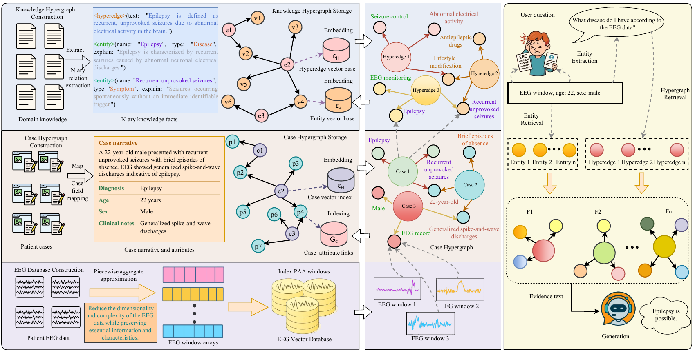

# EEG-MedRAG

Official implementation of [EEG-MedRAG: Enhancing EEG-based Clinical Decision-Making via Hierarchical Hypergraph Retrieval-Augmented Generation](https://arxiv.org/abs/2508.13735).

## Overview

EEG-MedRAG is a **three-layer hypergraph-based retrieval-augmented generation framework** for clinical EEG question answering. Its **knowledge hypergraph (KHG)** connects the medical concepts that participate in each fact drawn from guidelines and research articles. Its **case hypergraph (CHG)** represents each reference case as a hyperedge linking clinical findings, assessments, and recording conditions. Its **EEG vector database (EVD)** indexes multichannel EEG windows and links each window to its source case.

These links let EEG-MedRAG combine semantic retrieval with waveform matching. For a question about an EEG segment, the framework can retrieve similar waveforms in the same clinical domain, follow them to the corresponding cases, and use those cases to find relevant medical knowledge. The answer model can then interpret a waveform match in light of the clinical observations and literature associated with it.



## Environment Setup

Run the commands from the repository root with Python 3.11.

```sh
conda create -n eeg-medrag python=3.11 -y
conda activate eeg-medrag
pip install -r requirements.txt
```

## Running the experiment

### Preparation

| Directory | Contents | Download |
| --- | --- | --- |
| `contexts/` | Source literature for the knowledge hypergraph | [Google Drive](https://drive.google.com/drive/folders/1SAnCXdhvXxhKJ6thvoFRD6Zm1nIIOG8K?usp=sharing) |
| `datasets/` | Clinical case records, EEG signals, linking indexes, and the 700-question benchmark across seven clinical domains | [Hugging Face](https://huggingface.co/datasets/li-zan/EEG-MedRAG/tree/main) |

**API access.** We use [APIYI](https://www.apiyi.com/) for model requests. Save your APIYI key in `openai_api_key.txt` at the repository root.

### 1. Build the reference indexes

Build the knowledge hypergraph from the literature, then build the case hypergraph from the reference cases. Build one EEG index per clinical domain so that waveform retrieval spans the groups or recording conditions within that domain (e.g., patients and controls in the Parkinson's cohort).

```sh
python scripts/build_knowledge.py
python scripts/build_cases.py
python scripts/build_eeg.py --domain alzheimer
python scripts/build_eeg.py --domain depression
python scripts/build_eeg.py --domain epilepsy
python scripts/build_eeg.py --domain mild_tbi
python scripts/build_eeg.py --domain parkinson
python scripts/build_eeg.py --domain psychiatric
python scripts/build_eeg.py --domain sleep_deprivation
```

By default, the reference indexes and retrieval caches are stored in `exp/workspace/`, and run outputs are written under `exp/run/`. To resume after an interruption, rerun the same command with the same paths. **Use a fresh workspace and run directory when changing the data or experiment settings.**

### 2. Retrieve evidence

Retrieve evidence for all 700 questions. All three answer models use the same retrieval output, `exp/run/retrieval/all_retrieval.sqlite`.

```sh
python scripts/retrieve.py
```

### 3. Generate answers

Generate one set of predictions per answer model.

```sh
python scripts/generate.py --retrieval exp/run/retrieval/all_retrieval.sqlite --model gpt-4o-mini
# python scripts/generate.py --retrieval exp/run/retrieval/all_retrieval.sqlite --model gemini-2.5-flash
# python scripts/generate.py --retrieval exp/run/retrieval/all_retrieval.sqlite --model deepseek-v4-flash
```

### 4. Evaluate

Evaluate the quality of the generated answers.

```sh
python scripts/evaluate.py answers --predictions exp/run/generation/gpt-4o-mini/all_predictions.sqlite --bootstrap
# python scripts/evaluate.py answers --predictions exp/run/generation/gemini-2.5-flash/all_predictions.sqlite --bootstrap
# python scripts/evaluate.py answers --predictions exp/run/generation/deepseek-v4-flash/all_predictions.sqlite --bootstrap
```

Evaluate retrieval once for the shared evidence. The first command prepares the knowledge requirements used to score evidence coverage. The last command measures label agreement among the retrieved EEG neighbors for EEG-linked questions.

```sh
python scripts/evaluate.py prepare
python scripts/evaluate.py retrieval --retrieval exp/run/retrieval/all_retrieval.sqlite --rubric exp/run/evaluation/protocol/knowledge_rubric.json --bootstrap
python scripts/evaluate.py eeg --retrieval exp/run/retrieval/all_retrieval.sqlite
```

GPT-4.1-mini judges answer correctness, evidence coverage, and context relevance. The `--bootstrap` flag includes confidence intervals in the answer and retrieval reports.

### 5. Read the results

| Output under `exp/run/evaluation/` | Measures |
| --- | --- |
| `<model>/answers.json` | Answer correctness (AC) and token-level F1 |
| `retrieval.json` | Evidence coverage (EC), context relevance (CRel), and context length |
| `eeg.json` | EEG label agreement at five neighbors (LA@5) and its same-domain random expectation |

## Citation

If you find this work helpful in your research, please cite our paper.

```bibtex
@misc{meng2026eegmedragenhancingeegbasedclinical,
  title         = {{EEG-MedRAG}: Enhancing {EEG}-based Clinical Decision-Making via Hierarchical Hypergraph Retrieval-Augmented Generation},
  author        = {Lu Meng and Zan Li and Yi Wang and Yi Ding and Ziyue Zhu and Fang Li and Ziyu Jia and Anh Tuan Luu and Xinliang Zhou and Qingsong Wen and Haoran Luo},
  year          = {2026},
  eprint        = {2508.13735},
  archivePrefix = {arXiv},
  primaryClass  = {cs.CL},
  url           = {https://arxiv.org/abs/2508.13735}
}
```

## Acknowledgments

We thank the [HyperGraphRAG](https://github.com/LHRLAB/HyperGraphRAG) authors for sharing their work.
